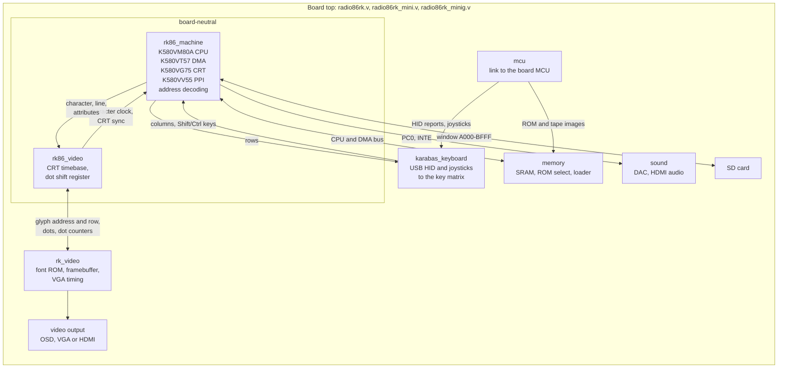

# Radio-86RK for the Karabas Go, Mini and Mini G

The Radio-86RK, a Soviet home computer of 1986 built around the KR580VM80A (an i8080
clone), as a core for the Karabas Go boards: Xilinx Spartan-6 XC6SLX25, built with ISE 14.7.
The machine is the FPGA replica of Dmitry Tselikov (2011), ported to Aeon Lite, to ZX UNO by
Andy Karpov and to the Karabas Go by Oleh Chastukhin.

- The core file for the three boards: `src/radio86rk.kg`.
- Tape images to put on the SD card: `pk/` (`.rkr`, `.rk`, `.gam`).
- Building the core: [tools/ise/README.md](tools/ise/README.md).

## Using the core

Open the OSD menu (`Menu+Esc`), choose **Tape image** (`Menu+T`) and pick a file; the image
is loaded into the memory. With **Autorun** on, the core types the command that starts it.
**ROM** selects the monitor: `BIOSSD` (with the SD card, the default) or `BIOS`.

## The Karabas keyboard

`Menu` is the Windows key of a USB keyboard.

| Keys | Action |
| --- | --- |
| `Menu+Esc` | OSD menu |
| `Menu+T` | load a tape image |
| `Menu+A` | autorun on / off |
| `Menu+V` | text colour: white / green |
| `Menu+M` | sound on / off |
| `Menu+B` | ROM: BIOSSD / BIOS |
| `Ctrl+Alt+Del` | reset |
| `Ctrl+Alt+Backspace` | back to the core loader |

The keys of a PC keyboard on the Radio-86RK keyboard (`src/rtl/mcu/hid_parser.vhd`):

| PC key | Radio-86RK key |
| --- | --- |
| letters, digits (also the keypad digits), `-` `,` `.` | the same keys |
| `=` | `:` |
| `` ` `` | `^` |
| `Home` | `↖` (cursor home) |
| `Del` | `СТР` (clear screen) |
| `Esc` | `АР2` |
| `F1`–`F5` | `F1`–`F5` |
| `Tab` | `ТАБ` |
| `Scroll Lock` | `ПС` (line feed) |
| `Enter` | `ВК` |
| `Backspace` | `ЗБ` |
| arrows | arrows |
| `Shift` | `СС` |
| left `Ctrl` | `УС` |
| right `Ctrl` | `РУС/ЛАТ` |

`;`, `/`, `@`, `[`, `\` and `]` of the Radio-86RK keyboard have no PC key. While the OSD menu
is open the keys go to the menu.

SEGA joysticks (both ports):

| Joystick | Action |
| --- | --- |
| D-pad | arrows |
| `A` | `ВК` |
| `B` | space |
| `X+Z` | reset |
| `R+Start` | OSD menu |

## Architecture

The machine and its native video are board-neutral modules; each board top connects the
machine to the board, and `rk_video` wraps the native video. Another platform (for example the Analogue Pocket) uses the same modules
with its own keyboard, memory and video output.

| Part | Board-neutral | Karabas boards | Another platform |
| --- | --- | --- | --- |
| CPU, DMA, CRT, PPI, decoding | `rk86_machine` | the same | the same |
| keyboard | rows, columns and `СС`/`УС`/`РУС/ЛАТ` of the PPI | `karabas_keyboard` | its own adapter |
| memory, ROM, loading | the CPU and DMA bus | SRAM, the MCU loader | its own |
| native video: CRT timebase, dots | `rk86_video` | the same | the same |
| video output | the dots, the dot step and counters, the font ROM port of `rk86_video` | `rk_video` (font ROM, framebuffer, VGA timing), OSD, VGA or HDMI | its own output |
| sound | PC0 and INTE | per-board mixing, DAC | its own |

The boundaries, the signals that cross them and the invariants are in
[docs/contract.md](docs/contract.md); `src/rk86_machine.prj` lists the board-neutral sources.

## License

The Radio-86RK replica: modified BSD, see [src/LICENSE.TXT](src/LICENSE.TXT).
